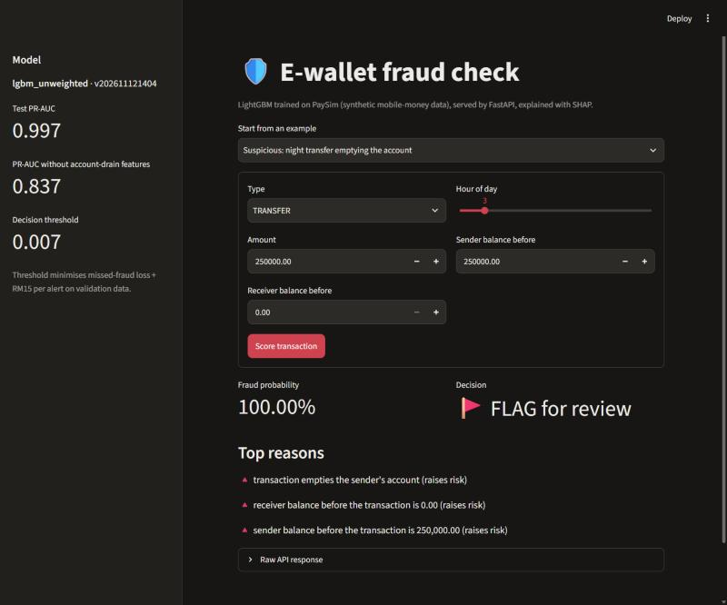
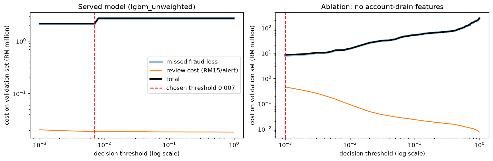
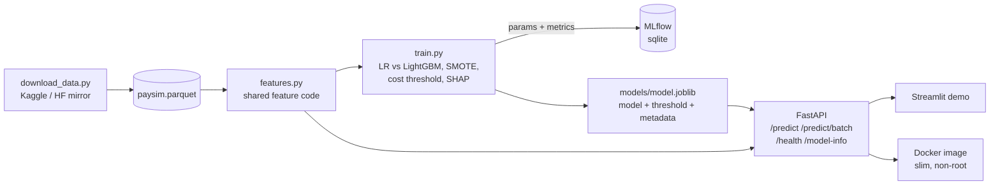

# Fraud Detection API

**An e-wallet fraud model served as a real API: it scores a transaction in ~75 ms and explains each decision in plain English.**




## The problem
A fraud team at an e-wallet (think Touch 'n Go, Boost, GrabPay) has to decide **before a transfer goes through** whether to let it pass or hold it for review. They need three things from a model:

1. **Catch the expensive fraud.** One missed account takeover can cost more than a thousand reviews.
2. **Keep alert volume workable.** Every flag costs analyst time and annoys a real customer.
3. **Explain why**, so the analyst can act and the decision can be defended to the customer and the regulator (BNM's RMiT and fair-treatment expectations).

This project builds that service end to end: EDA, leakage-safe features, model comparison, a threshold chosen on business cost, SHAP reasons and a containerised FastAPI service.

## Data
[PaySim](https://www.kaggle.com/datasets/ealaxi/paysim1): 6.36M **synthetic** mobile-money transactions over 31 days, 8,213 of them fraud (0.13%).
`scripts/download_data.py` tries Kaggle first and falls back to a [public Hugging Face mirror](https://huggingface.co/datasets/purulalwani/Synthetic-Financial-Datasets-For-Fraud-Detection) whose row and fraud counts match the original exactly. Raw data is not committed.

## Key findings
| | |
|---|---|
| Fraud only happens in **TRANSFER** and **CASH_OUT** | the model scores only those (2.77M rows); other types are short-circuited to *allow* |
| **97.6%** of fraud empties the sender's account (legit: ~0%) | strongest signal, but it is how the simulator generates fraud |
| Post-transaction balances are a **leak** | 90% of legit rows don't reconcile vs 0.5% of fraud; a pre-authorisation API can't see them anyway, so they are **dropped** |
| `isFlaggedFraud` fires on 16 rows, all fraud | a rule output, not an input: **dropped** |

### Results (held-out test set, 415k transactions, 1,232 fraud)
| Model | PR-AUC | Recall @ 95% precision |
|---|---|---|
| Logistic regression (class weights) | 0.997 | 99.7% |
| **LightGBM (served)** | **0.997** | **99.7%** |
| LightGBM **without** account-drain features (ablation) | 0.837 | 57.1% |
| Logistic regression **without** account-drain features | 0.294 | 0.0% |

PaySim is close to linearly separable once you know whether the account was drained, so logistic regression nearly matches LightGBM. **The ablation is the honest number**: it shows what's left when the simulator's main giveaway is removed. It's also where LightGBM earns its place (0.84 vs 0.29 PR-AUC).

### Business trade-off
Cost model: a missed fraud costs its amount, and every alert costs RM15 (review plus friction). PaySim units are treated as RM.

| Policy (test set) | Missed fraud | Alerts | Total cost |
|---|---|---|---|
| No model | 1,232 | 0 | RM 1,885M |
| Served model @ cost-optimal 0.007 | 4 | 1,253 (25 false) | **RM 0.84M** |
| Ablation model @ default 0.5 | 374 | 979 | RM 75.1M |
| Ablation model @ cost-optimal 0.001 | 8 | 30,762 | **RM 5.3M** |



For the imperfect model, **choosing the threshold on cost rather than the 0.5 default saves ~RM70M** on the test set, at the price of 30x more alerts. That is a capacity question for the fraud team, and it's why the threshold is a business setting, not a modelling one.

## Architecture

The same `build_features()` runs in training and serving, so there's no train/serve skew.

## API
| Method | Path | Purpose |
|---|---|---|
| `POST` | `/predict` | score one transaction |
| `POST` | `/predict/batch` | score up to 1,000 |
| `GET` | `/health` | liveness + model loaded |
| `GET` | `/model-info` | version, threshold, metrics, features |

Interactive docs at `/docs`.

```bash
curl -X POST localhost:8000/predict -H "Content-Type: application/json" \
  -d '{"transaction_id":"txn-001","type":"TRANSFER","amount":250000,"oldbalance_orig":250000,"oldbalance_dest":0,"hour":3}'
```
```json
{
  "transaction_id": "txn-001",
  "fraud_probability": 0.999984,
  "decision": "flag",
  "threshold": 0.007,
  "scored": true,
  "reasons": [
    {"feature": "drains_account", "impact": 21.62, "direction": "raises risk",
     "text": "transaction empties the sender's account (raises risk)"},
    {"feature": "oldbalanceDest", "impact": 0.57, "direction": "raises risk",
     "text": "receiver balance before the transaction is 0.00 (raises risk)"},
    {"feature": "oldbalanceOrg", "impact": 0.11, "direction": "raises risk",
     "text": "sender balance before the transaction is 250,000.00 (raises risk)"}
  ],
  "model_version": "202611121422"
}
```
```bash
curl -X POST localhost:8000/predict/batch -H "Content-Type: application/json" \
  -d '{"transactions":[{"type":"CASH_OUT","amount":1800,"oldbalance_orig":52000,"oldbalance_dest":120000,"hour":14},{"type":"PAYMENT","amount":120,"oldbalance_orig":900,"oldbalance_dest":0,"hour":12}]}'
```
Invalid input (negative amount, hour 24, unknown type, extra fields) returns `422`.

## How to run
```bash
uv sync --all-groups
uv run python scripts/download_data.py      # ~270 MB
uv run python -m fraud.train                # ~2 min, writes models/ and reports/
uv run uvicorn api.main:app --port 8000     # API on :8000
uv run --group demo streamlit run demo/app.py   # demo on :8501
uv run pytest                               # 26 tests
uv run mlflow ui --backend-store-uri sqlite:///mlflow.db   # experiment history
```
With Docker (the trained model is committed, so no data download is needed):
```bash
docker compose up --build      # API :8000, demo :8501
```

## Model card
- **Model:** LightGBM, unweighted, early-stopped on validation log-loss. It was chosen over SMOTE and class-weighted variants because their PR-AUC gain was within noise (≤ 0.0004) while they distort probabilities.
- **Intended use:** portfolio demonstration of a pre-authorisation fraud scorer. **Not** for real decisions.
- **Training data:** PaySim TRANSFER + CASH_OUT, stratified 70/15/15 split. A time-based split (train on steps ≤ 500) gives PR-AUC 0.9998, so the random split isn't flattering the model.
- **Features:** type, amount, pre-transaction balances, hour, and derived flags (drained account, zero balances, night). No IDs, no post-transaction balances.
- **Metrics:** PR-AUC, recall at fixed precision, confusion matrix, cost. Not accuracy: predicting "legit" for everything scores 99.7%.
- **Limitations:**
  - Synthetic data with a very clean fraud pattern; real performance would be far lower (see the ablation).
  - No customer history, device or velocity features.
  - Probabilities are not separately calibrated.
  - The cost model ignores analyst capacity, so the cost-optimal ablation threshold flags 7% of traffic.
- **Fairness note:** PaySim has no demographic attributes, so fairness can't be measured here. In production the "drained account" and "night-time" signals could disproportionately flag shift workers or low-balance users who legitimately move their whole balance. Monitor false-positive rates by customer segment before deployment, and always route flags to human review rather than auto-blocking.
- **Explainability:** exact TreeSHAP per request, top 3 reasons in plain English.

## Stack
Python 3.12 · uv · pandas · scikit-learn · LightGBM · imbalanced-learn · SHAP · MLflow · FastAPI · Pydantic · Streamlit · Docker · GitHub Actions · ruff · pytest

## Project layout
```
scripts/download_data.py    data download (Kaggle -> HF fallback)
notebooks/01_eda.ipynb      EDA + leakage analysis
notebooks/02_modelling.ipynb  model comparison, threshold, SHAP
src/fraud/                  features, metrics/cost model, explainer, training
api/                        FastAPI app, schemas, model loader
demo/app.py                 Streamlit page that calls the API
models/model.joblib         trained model bundle (~165 KB)
reports/                    metrics.json + figures
```

## Limitations and next steps
- Train on real (or harder synthetic) data with customer history and velocity features.
- Optimise the threshold under a daily alert budget instead of unconstrained cost.
- Add drift monitoring and calibrated probabilities.
- Deploy to AWS (project 09): the image is already slim, non-root and health-checked.
